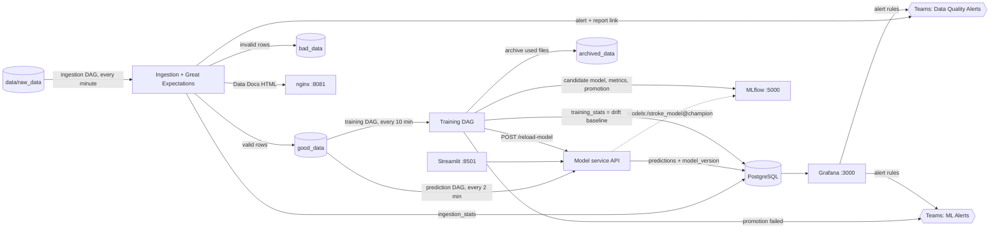

# DSP Stroke Prediction — end-to-end MLOps project (Defense 1 + Defense 2)

Stroke-risk prediction on the Kaggle stroke dataset, built for the *Data Science in Production* course.
The model itself is deliberately simple; the project is about the **production system around it**:

| Part | What it does | Technology |
|---|---|---|
| Web UI | single + batch predictions, past predictions | Streamlit |
| Model service | serves the **MLflow champion** model, stores predictions, hot-reloads new models | FastAPI, SQLAlchemy |
| Ingestion job | validates incoming files, splits good/bad rows, stores stats, alerts, Data Docs | Airflow 3 + Great Expectations |
| Prediction job | scheduled batch predictions on good data | Airflow 3 |
| **Training job** *(Defense 2)* | retrains, compares to the champion, promotes, reloads the API, archives data | Airflow 3 + MLflow |
| **Monitoring** *(Defense 2)* | data-quality dashboard, data-drift & prediction dashboard, alert rules → Teams | Grafana |
| **Data Docs hosting** *(Defense 2)* | GX validation reports reachable from alert links | nginx |
| **CI/CD** | flake8 + pytest on PRs; GitHub Release with semantic version on merge to `main` | GitHub Actions |



---

## 1. Prerequisites

- **Docker Desktop** with Compose v2 (`docker compose version` — the space, not `docker-compose`), ~8 GB RAM free for Docker.
- **Python 3.12** only to run the data scripts / tests on the host (the apps run in Docker).
- Free host ports: `8501` (webapp), `8080` (Airflow), `5000` (MLflow), `3000` (Grafana), `8081` (Data Docs).
  Change `MLFLOW_PORT`, `GRAFANA_PORT`, `NGINX_PORT` in `.env` if one is taken.
- *(optional)* two Microsoft Teams channels with an incoming webhook / Workflows URL (see §4).

## 2. Setup and run

```bash
cd team2_docker_env
cp .env.example .env            # then edit .env (secrets below)
python3 -c "from cryptography.fernet import Fernet; print(Fernet.generate_key().decode())"   # -> AIRFLOW__CORE__FERNET_KEY
python3 -c "import secrets; print(secrets.token_hex(32))"   # run 2x -> AIRFLOW__API_AUTH__JWT_SECRET and AIRFLOW__WEBSERVER__SECRET_KEY
bash run_project.sh             # installs data-script deps, generates 30 raw files, `docker compose up --build`
```

* The first start **builds the Airflow and MLflow images** (several minutes). `run_project.sh` runs in the foreground — leave it open.
* It resets all volumes on every run (clean demo state). To keep data between runs use `docker compose up -d` instead.
* Startup order is enforced with health checks: `db → mlflow → mlflow-bootstrap → model_service → webapp`.
  `mlflow-bootstrap` trains the **baseline model (v1)**, registers it and aliases it `champion` so the API serves from the registry from the first second.
* Windows: run `run_project.sh` from WSL or Git Bash.

### Accessing the services

| Service | URL | Login |
|---|---|---|
| Streamlit webapp | http://localhost:8501 | – |
| Airflow | http://localhost:8080 | `admin` / `admin` (fixed in `team2_docker_env/airflow_auth/passwords.json`; change it there) |
| MLflow (experiments + model registry) | http://localhost:5000 | – |
| Grafana (2 dashboards, folder **DSP**) | http://localhost:3000 | `admin` / `admin` (change in `.env`) |
| Great Expectations Data Docs (nginx) | http://localhost:8081 | – |
| Model service API | *internal* `http://model_service:8000` | `docker compose exec model_service curl -s localhost:8000/model-info` |

## 3. How it works

### Ingestion → prediction (Defense 1, unchanged behaviour)
1. `ingestion_dag` (every minute) takes a random file from `data/raw_data`, validates it with the Great Expectations checkpoint, saves error statistics to PostgreSQL (`ingestion_stats`, `ingestion_error_types`), moves valid rows to `good_data` and invalid rows to `bad_data` (a file with a missing column goes entirely to `bad_data`).
2. Criticality: **low** ≤ 10 % invalid rows, **medium** ≤ 50 %, **high** > 50 % or a missing column. Medium/high send a Teams alert to **Data Quality Alerts** with a button that opens the **rendered Data Docs report of that exact run** (served by nginx).
3. `prediction_dag` (every 2 min) sends new `good_data` files to the API; predictions are stored with the **model version** that produced them.

### Training, promotion and hot reload (Defense 2) — `training_dag`
Every 10 minutes (and on demand from the Airflow UI):

```
load_data → train_model → save_training_stats → evaluate_candidate → promote_to_champion ─┬→ notify_api_reload
                                                                                           └→ archive_data
```

| Task | What happens |
|---|---|
| `load_data` | Counts `good_data` files not yet used by a training run; **skips the whole run** if fewer than `min_new_files` (default 5). |
| `train_model` | Trains the candidate on reference train split + labelled good data, logs params/metrics/model to MLflow and registers a **new model version**. |
| `save_training_stats` | Stores the candidate's feature statistics in `training_stats` (**not yet** the baseline). |
| `evaluate_candidate` | Scores candidate **and current champion** on the *same fixed test set*, measures inference latency, applies the promotion rule, logs the comparison to MLflow. If rejected → alert to **ML Alerts**. |
| `promote_to_champion` | Moves the MLflow alias `champion` to the candidate **and** makes its `training_stats` the drift baseline. Skipped when rejected. |
| `notify_api_reload` | `POST /reload-model` → the API swaps the model in memory (no restart) and verifies the new version label. |
| `archive_data` | Moves the used files from `good_data` to `archived_data` (only files the prediction DAG already scored). |

**Promotion rule:** candidate ≥ champion on the primary metric (default **F1**, configurable) **and** mean single-row inference time below the threshold (default 200 ms). No champion yet → promoted.
All thresholds are DAG params, editable in *Trigger DAG w/ config*: `min_new_files`, `primary_metric`, `inference_time_threshold_ms`, `min_improvement`.

**Where labels and the test set come from.** Files in `good_data` are inference files (no `stroke` label). Ground truth normally arrives later; we simulate this *delayed label feedback* by looking labels up in the labelled reference dataset. The **test set is a fixed, stratified 20 % hold-out of that dataset** (constant seed) — champion and candidate are always compared on identical rows, and any good row that matches a test row is removed from training (no leakage).

**Model serving.** The API loads `models:/stroke_model@champion`. If MLflow has no champion / is unreachable at startup it retries, then falls back to the bundled `model_pipeline.pkl` so Defense 1 behaviour keeps working.

### Monitoring (Defense 2) — Grafana, provisioned as code
Dashboards, datasource, contact points, routing policy and alert rules live in `team6_monitoring/grafana/` and load automatically.

* **DSP | Ingested data quality** — invalid % per file, errors by category (completeness / validity / consistency / type / schema), criticality over time, rejected-row share, top error types, schema errors.
* **DSP | Data drift & prediction monitoring** — serving-vs-training mean (pick a feature), z-score drift score, categorical drift distance, out-of-range share, positive-prediction rate vs baseline, probability distribution, constant-prediction detector, positive rate **per model version**.
* **Baseline = the training statistics of the current champion only** (`training_stats.is_baseline`).
* **6 alert rules** → `team=data_quality` → *Data Quality Alerts* channel, `team=ml` → *ML Alerts* channel.

## 4. Microsoft Teams webhooks (optional but needed for the alert demo)
Create two channels, e.g. **Data Quality Alerts** and **ML Alerts**; in each: *⋯ → Workflows → "Post to a channel when a webhook request is received"* and copy the URL into `.env`:
`TEAMS_DQ_WEBHOOK_URL` (data quality) and `TEAMS_ML_WEBHOOK_URL` (ML). Unset = alerts are skipped silently, nothing breaks.

## 5. Demo data and populating the dashboards
```bash
cd team3_data_training
# the 5 files for the live demo (1 all-errors, 3 clean, 1 mixed) + schema-error + drifted files, kept OUTSIDE raw_data
python scripts/generate_demo_data.py --input healthcare-dataset-stroke-data.xls --output-dir demo_files
# fill the dashboards with GENUINE pipeline data (drops one file/min into raw_data: normal → bad burst → normal → drift)
python scripts/simulate_traffic.py --input healthcare-dataset-stroke-data.xls --raw-dir data/raw_data --interval 60 --duration-min 240
```
Start the simulator hours (or days) before the defense. Details: `docs/DEMO_SCRIPT.md`.
**File names must be unique** — the DAGs track processed files by name.

## 6. Tests and CI/CD
```bash
# lint (whole repo) – separate from tests
pip install -r team5_service_web/requirements-dev.txt && flake8 .
# API
cd team5_service_web/model_service && pip install -r requirements.txt && PYTHONPATH=. pytest tests -q
# data pipeline, GX, training logic, alerts, demo data
cd team3_data_training && pip install -r scripts/requirements.txt -r model_training/requirements.txt -r tests/requirements-test.txt \
  && PYTHONPATH=../team1_airflow pytest tests -q
# monitoring SQL (needs a PostgreSQL)
MONITORING_TEST_DB_URL=postgresql://user:pw@localhost:5432/testdb pytest team6_monitoring/tests -q
```
* **CI** (`.github/workflows/ci.yml`, on PRs to `develop`): lint · model-service tests · data-pipeline tests · monitoring tests on a PostgreSQL service · `docker compose config` + release-script tests.
* **CD** (`.github/workflows/release.yml`, on push to `main` i.e. `develop → main` merge): computes the next **semantic version** from the commits since the last tag (`fix:`-only → patch, otherwise minor, `feat!:`/`BREAKING CHANGE` → major, first release `v1.0.0`) and publishes a **GitHub Release** with notes.
* Git workflow: `docs/GIT_WORKFLOW.md`.

## 7. Repository layout
```
team1_airflow/            Airflow image (Dockerfile, requirements) + dags/ (ingestion, prediction, training) + dags/common/ helpers
team2_docker_env/         docker-compose.yml, .env.example, run_project.sh, mlflow/ + nginx/ configs, DB init
team3_data_training/      dataset, split / error-injection / demo-data / traffic scripts, notebook, tests
team4_great_expectation/  Great Expectations project (suite, validation definition, checkpoint)
team5_service_web/        model_service (FastAPI) + webapp (Streamlit)
team6_monitoring/         Grafana provisioning (datasource, dashboards, contact points, policies, alert rules) + generator + SQL tests
docs/                     defense guide, demo script, task split, git workflow, slides
.github/                  CI + CD workflows, release-version script
```

## 8. Design decisions and known limitations
* **Library versions are pinned to Airflow's constraints file** (pandas 2.1.4, numpy 1.26.4, scikit-learn 1.7.2) in *both* the Airflow and API images, so a model trained by the DAG unpickles identically in the API.
* **Model configuration changed vs the Defense 1 notebook:** `class_weight="balanced_subsample"`, `min_samples_leaf=10`. The notebook's forest practically never predicts a stroke on unseen data (F1 = 0 on the hold-out), which makes F1 useless for promotion; the new one reaches F1 ≈ 0.34 / ROC-AUC ≈ 0.82. Accuracy is *not* used because ~95 % of samples are negative.
* The hold-out contains only ~50 positive cases, so F1 differences between candidate and champion are noisy; promotion/rejection outcomes vary from run to run. That is why the metric and thresholds are parameters.
* Labels of ingested files are simulated by lookup in the reference dataset (see §3). Rows that cannot be matched are reported and not used.
* With 10-row files, *low* criticality (≤ 10 %) is effectively unreachable (1/10 = 10 % is already *medium* per the spec's thresholds).
* MLflow's `skops` default serialization is overridden with `cloudpickle`; models from untrusted sources must never be loaded with it.
* MLflow's host allow-list is configured for the compose service names (`--allowed-hosts`); an additional hostname must be added there.
* `docker compose down -v` is needed once when upgrading an existing Defense 1 volume (the `mlflow` database is created by the Postgres init script).
